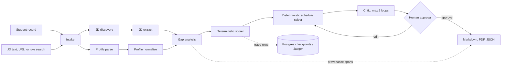
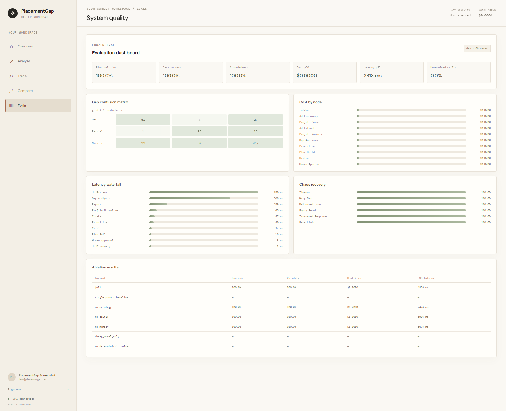

# PlacementGap

PlacementGap compares a student's transcript, resume, and project record with one specific job description. It returns evidence-backed skill gaps, ranks them deterministically, and builds a prerequisite-ordered plan that fits the stated study budget. Every extracted fact carries a source document id, character range, and extractor confidence.

## Architecture



The `jd_discovery` and `profile_parse` branches run in parallel. Pydantic contracts validate node boundaries. In this build, optional model calls handle JD extraction proposals and plan critique; profile parsing/normalization and gap comparison use deterministic evidence rules. Scheduling, scoring, effort lookups, and plan validity checks are Python. Fixture mode runs without an API key.

## Quickstart

Requirements: Docker Desktop with Compose. No model key is needed for the fixture demo.

```bash
docker compose up -d --build
make seed
```

The first page is the public PlacementGap landing page. **Get started** opens account creation; verified sign-in opens the career workspace. In local fixture mode, email codes are shown in the verification panel because SMTP is not configured. Set SMTP values to deliver those codes by email. The Overview keeps the last run summary and links into separate Analyze, Trace, Compare, and Evals sections.

Open [http://127.0.0.1:5173](http://127.0.0.1:5173) for the agent console, [http://127.0.0.1:8000/docs](http://127.0.0.1:8000/docs) for the API, and [http://127.0.0.1:16686](http://127.0.0.1:16686) for Jaeger. The UI accepts pasted text and PDF/DOCX uploads, streams node and tool events, pauses at approval, and downloads the final report.

For a persistent hosted deployment on Render, follow [DEPLOY_RENDER.md](DEPLOY_RENDER.md). The Blueprint builds and serves the UI/API on one HTTPS origin and provisions Postgres plus persistent storage.

In PowerShell, if GNU Make is not installed, use the same container commands directly:

```powershell
docker compose exec -T api python -m evals.seed
docker compose exec -T api pytest -q tests
docker compose exec -T api python -m evals.demo
docker compose exec -T api python -m evals.runner
docker compose exec -T api python -m evals.ablations --heldout --confirm
docker compose exec -T api python -m evals.chaos --chaos-rate 0.3
docker compose exec -T api python -m evals.calibrate
```

## Acceptance commands

```bash
docker compose up -d && make seed
make test
make demo
make eval
make ablate
make chaos
make calibrate
```

`make demo` writes `data/demo/report.pdf`, `report.md`, and `report.json`. `make eval` runs the frozen 60-case dev split and writes `evals/reports/dev-<timestamp>.json`. The heldout runner refuses by default; pass `--heldout --confirm` only after finalizing changes. `make ablate` invokes that explicit gate and updates the table below.

## Ablation results

<!-- ABLATION_TABLE_START -->

| Variant | Success rate | Plan validity | Cost / run (USD) | p95 latency (ms) |
|---|---:|---:|---:|---:|
| full | 100.0% | 100.0% | $0.0000 | 4826 |
| single_prompt_baseline | N/A | N/A | N/A | N/A |
| no_ontology | 100.0% | 100.0% | $0.0000 | 2474 |
| no_critic | 100.0% | 100.0% | $0.0000 | 3986 |
| no_memory | 100.0% | 100.0% | $0.0000 | 5675 |
| cheap_model_only | N/A | N/A | N/A | N/A |
| no_deterministic_solver | N/A | N/A | N/A | N/A |

Measured rows were run independently on the frozen fixture split. `N/A` rows require a recorded or live model provider and are never filled with estimated multipliers. The full per-variant report is `evals/reports/ablation-20261017-065021.json`.

<!-- ABLATION_TABLE_END -->

The measured rows are independent executions on the frozen heldout fixture set. Model-specific rows (single-prompt, cheap-model-only, and LLM scheduling) are `N/A` in fixture mode because model calls are disabled; the harness does not estimate their scores. `python -m evals.ablations --heldout --confirm` regenerates both the table and the per-variant JSON report.

## Eval dashboard

The web dashboard reads the latest dev or confirmed heldout eval report and adds the latest chaos recovery and ablation results. Run `make eval`, `make chaos`, and `make ablate`, then open the **Evals** tab. On Windows with Edge installed, `node scripts/capture_dashboard.mjs` refreshes the committed screenshot.



## Evaluation and reproducibility

- `python -m evals.runner` regenerates extraction, canonicalization, gap, plan-validity, groundedness, trajectory, and ops metrics for the dev split.
- `python -m evals.check_ontology_aliases` prints accuracy by canonicalization method across the bundled labeled aliases.
- `python -m evals.chaos --chaos-rate 0.3` writes recovery rates for timeout, HTTP 5xx, malformed JSON, empty results, truncation, and rate limits.
- `python -m evals.calibrate` prints Cohen's kappa for the two versioned judges.
- `python -m evals.label_tool --case-id pg-001 --skill-id python --verdict has` edits a dev label; heldout labels are protected.

The 100-pair fixture set is seeded by `evals/datasets/generate.py` with seed `41027` and split 60/20/20. Calibration references are generated with seed `evals/datasets/generate_calibration.py`. Those references are synthetic offline bootstrap labels, not a human study; replace them with blinded labels before claiming human calibration. `evals/reports/` is generated output, not a committed performance guarantee.

## Model setup

Set `PLACEMENTGAP_USE_LLM=1` and a provider key such as `OPENAI_API_KEY` to enable LiteLLM calls. JD extraction and plan critique use the routed models; profile parsing/normalization, gap comparison, ranking, and scheduling currently use deterministic fixture logic. `config/models.yaml` routes extraction to a cheaper model and critique to a stronger model. `PLACEMENTGAP_MODEL_OVERRIDE` is available for controlled runs. A run-level USD/token ceiling is enforced; budget exhaustion skips optional model work, records the reduction, and keeps deterministic analysis available.

## Account and sign-in setup

Manual account creation collects a full name, email, phone, and password, then verifies email with a one-time code. Sign-in supports either a password or a one-time email code; forgot-password recovery also uses email codes. These flows use the SQLite account store in `data/auth.sqlite3`; passwords are PBKDF2-hashed and session tokens are opaque, hashed in storage, and issued in HttpOnly cookies. The local `data/auth.secret` protects code hashes and persists with the Compose data volume. Set `AUTH_SECRET` to a random value of at least 32 bytes in production and run behind HTTPS.

To enable sign-in providers and send OTPs, copy the relevant variable names from `.env.example` into your private `.env` and fill them in. Compose passes the Google, Microsoft, GitHub, and SMTP values to the API. Register these exact local callback URLs with the provider apps:

- Google: `http://127.0.0.1:8000/auth/google/callback`
- Microsoft: `http://127.0.0.1:8000/auth/microsoft/callback`
- GitHub: `http://127.0.0.1:8000/auth/github/callback`

Google and Microsoft use the `127.0.0.1` host so both provider callbacks, the frontend return page, and session cookie stay on one hostname. Register `http://127.0.0.1:8000/auth/microsoft/callback` in the Entra app. Microsoft Entra's portal may reject HTTP loopback IP URIs; its [redirect URI guidance](https://learn.microsoft.com/en-us/entra/identity-platform/reply-url) describes adding them through the app manifest. After editing `.env`, run `docker compose up -d --force-recreate api` so the API reloads the settings. `SMTP_HOST`, `SMTP_FROM`, `SMTP_PORT`, and optional `SMTP_USERNAME`/`SMTP_PASSWORD` configure email delivery. If SMTP is absent in development, the UI labels and displays the local OTP so the full flow remains testable offline. In production, missing SMTP or `AUTH_SECRET` prevents insecure fallback behavior.

## Trace and storage

- LangGraph checkpoints use Postgres through `langgraph-checkpoint-postgres`.
- Profile payloads and skill embeddings, plus same-role JD semantic cache vectors, use Postgres/pgvector when `DATABASE_URL` is set. SQLite is the local fallback.
- API run metadata, local event replay, and generated files use the mounted `data/` volume.
- Tool and model calls write structured trace rows with model/tool, node, prompt version, tokens, cost, latency, retry count, and cache status. OTLP spans export to Jaeger in Compose.
- URLs are restricted to public HTTP(S) hosts and checked against `robots.txt`; page text is treated as untrusted. LLM prompts put untrusted text inside explicit `UNTRUSTED_INPUT_BEGIN` / `UNTRUSTED_INPUT_END` markers and expose no tools.

## Known limitations

- Offline requirement extraction uses ontology phrase matching; nuanced implicit requirements benefit from an enabled model and still need source-span validation.
- Scanned PDF OCR requires Tesseract. Multi-column text extraction is layout-aware but not perfect for every transcript design.
- The bundled hashed n-gram embedding is deterministic and useful for offline matching; it is not a semantic embedding model. A production embedding provider can replace it while keeping the vector contract.
- Resource links are curated fixtures and are not continuously checked in offline mode. The dead-link metric remains null until links are checked.
- Calibration labels are synthetic offline bootstrap references and do not represent blinded human agreement. Model-only ablation rows are unavailable until recorded model cassettes are supplied; other rows are measured fixture runs.
- The deterministic greedy solver can spread one learning objective across multiple weeks and explicitly defers work it cannot fit. It is a bounded heuristic, not a globally optimal solver.
- The frozen resource relevance@5 score is modest, and offline resources are curated fixtures; dead-link rate stays unmeasured until links are checked.
- SQLite is used for local API run indexing and event replay; Postgres is authoritative for graph checkpoints and profile/cache data when Compose is running.
